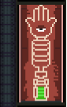
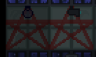
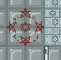
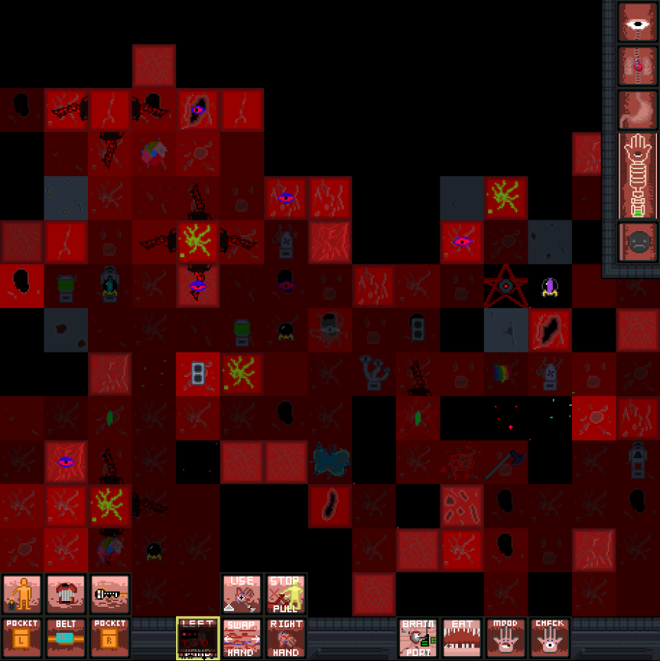
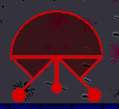
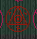

how 2 engine

1. Go to blue room, set "advanced power storage unit" OUTPUT to 10
2. Leave the blue room, run to the "Local Gas Control Console"
3. Turn on
4. Open local stationary tanks
5. Wait a bit, turn on igniters
6. Open gas floodgates
7. You should probably close the local gas tanks, but you also can leave them open anyway.

# QnA

### HALP WASD NO WORK
- Movement: Arrow keys
- Toggle throw: Shift
- Swap hands: MMB / Page Up
- Stop Pulling: Page Down
- Use item in hand: Insert
- Eat item in hand: Delete
- Blink (spam to remove ticks): Alt
- Right click: How you interact with most things, like examining, using computers, interacting with NPCs and others.

### I AM IN HELL I THINK
Find an "altar" with an eye with rainbow colours, "pray" at it, and you might escape?

### "Due to logicists problems-"
Follow the south path, keep going south, click on doors to open them, go through the red portal.

### "Where the fuck am I?" appears in chat
Congrats, you wandered too far on the Baikonur-5 landing site/into space and got lost. Just run around in circles until you find the path again.

### My chat keeps spamming with "HOLY LENIN"
You're panicking. Find an emergency calming syringe, they're found in lockers. Alternatively, take CBD, benzos, GABAs, alcohol, opioids or barbiturates to calm down.

### What's with the demonic runes everywhere?
See below on "Sigils"

### I am constantly throwing things
Press Shift, your muscle memory is betraying you. It can be used to examine, but you're also constantly toggling throw on and off, best to just right click.

### What's Euphoria?
 
Euphoria (the thing with a eye on a hand) is your mood. The smiley face is actually your libido. Euphoria is needed to do magic, stay alive, and to use some weapons. Gain euphoria by doing drugs, wanking your cock or having sex, lose it by staying sober, getting injured, getting a hangover(?). A lack of euphoria may make you depressed, which can have lethal consequences.

### There's ghosts chasing me :(
Find a Petrine Cross (upside down cross) and click the ghosts with it to banish them. Alternatively, call the purificator.

### Where the fuck is the purificator outpost/mining/geology
There's a few ways to get there. The easiest is to go to the station, into the labs, then go into the teleporter found in the geology bay.

Alternatively, on Baikonur-5 (the moon), follow the path down til you get to the first bend, then go left and down into a narrow cave. If you're in a corridor that goes up/down, go down and then down-left. If you're in a corridor that goes left/right, go left. Find a red door called "Mushroom woods".  

Alternative, use the teleport code "mine" or "purificator".

Less reliable way: Follow the path but go east, then east again until you come to a corridor that lets you go north or south. Go south, then south-east until you find a red door called "Mushroom woods".  

### I'm a spectre and my game zoom is fucked up
Feature!

### How do I get rid of ticks?
Blink rapidly by spamming alt, then click the remaining ones.

### How do I get out of a space ship/off the bike?
Machinery > Unmount OR type "Unmount" in the verb bar, press space, then enter.

### I know nothing about drugs
Now is your time to discover them.

### Give me a damn hint
- Opioids = Gives immense euphoria, pain relief, makes you sleepy, highly addictive
- Benzos = Pain relief, makes you sleepy, also addictive but they aren't opioids
- Psychadelics / dissociatives = Makes you hallucinate
- Amphetamine / methamphetamine = Makes you go fast
- THC = The chemical in weed that gets you high
- CBD = Another chemical in weed that calms you down, doesn't make you high

### How do I buy drugs?
1. Find a bluespace encryptor, looks like a phone kinda
2. Find rubles, gems, supply cartidges, and shove them into the encryptor to sell. You can sell most things, even pretty important things.
3. Revel in the beautiful darknet UI and find something you wanna buy
4. The chat will tell you vaguely where its located. Run over and run around until you bump into a crate.
5. Open the crate and take your goods. If you can't find it, either you got scammed, are blind, or someone stole it.

### Explain the jobs I'm unfamiliar with
- Geologist = Miner
- Operator = Human AI, basically
- Cognitologist = Chemical researcher
- Purificator = Ghostbuster
- Prosecutor = Head of security

# Rough map
Found a screenshot that uses old tiles, that shows most of the station. The colours should be pretty obvious but in case you're slow:
- Orange = Engineering
- Blue = Medical
- Purple = Research
- Red = Security
- Green = Bridge

# Sigils

## Pentacle
* Appearance: Crude drawings of pentagrams, flashing red and pink.  
* Purpose: Stops spectres and veterans from walking over it.
* Creatable by a purificator by draining their euphoria.

## Lesser Banishment Pentagram
* Appearance: Neatly drawn flashing pentagram with no circle.  
* Purpose: Banishes spectres and veterans. AKA deletes you.
* Creatable by a purificator by draining their blood with an Automatic Lesser Banisher.

## Greater Banishment Pentagram
* Appearance:   
* Purpose: Banishes all nearby spectres at the cost of sending the user and all the other spectres into the abyss. *You fall into the waves of chaos.*   
* Creatable by a purificator, kills the user, make one using the Greater Banishing Sigil Tracer.

## Observation Sigil
Appearance:   
Purpose: Respawns you as a spectre that can haunt the station.

## Hellraiser
Appearance:   
Purpose: Taking things from "spatial pockets". You need to feed it an amoeba core from science and sacrifice some blood to use it.

## Lifedraining Sigil
Appearnace: ???
Purpose: ???
Code:? JVAV

Orb of Monitoring is NZTH, whatever it 

# Doing magic
The Machinery sucks a drop of your blood. Now you can try to use some ritual.

## Wizard  101
- et herbis - The Machinae channels some magic and transfers some herbs to your body.
- per vim Spiritus - The Machinae channels some magic and takes a bit of exotic matter to gift local pseudo-ghosts and so-called 'observers' with some mutilated, but at least material human bodies
- exorcismo - The Machinae channels some magic and banishes all of the 'spirits' around.

# Enemies
### Popobava
Behaviour: Demon spirit that will rape you. When it's done with you, you will randomly scream Russian that translates into "I WAS FAGGED BY POPOBOVA".

### Veteran

### Spectre

### Hodovochka
Appearance: Worm-like creature standing upright
Behaviour: Can be made "insane" by a disoritentation beacon, it seeks out people's throats. Can teleport, and spreads disease.

# Other neekothing guides and info
There are books in-game that explain shit to you. Aside from koto's own guide, here are some guides from the discord with added formatting:
Note: May be in broken English.

## ENGINEERS GUIDE
Small note for Project Dirs, Operators, Chemists, 

### HOW TO WIRE:

Just click a turf with a cable, then read what it says on the top of menu and select a proper number.

It IS the most important part of your job so read it carefully.

### Turbine engine:

First, set up the turbine engine.
1. Go to the blue room (a.k.a. "Engineering secure room") at the northeast of engineering.
2. Now go to the east of this room and go through "Special supplies door" (yea, transparent one).
3. Here, use "Set OUTPUT" verb on a battery to the north of the spehssuit and set fucking output to 10, then click this battery (it will say what you just set it to output. Congrats)
4. Wait a five-ten secs, then go to the main engineering (use western blue door if you don't know WERE2GO?????)
5. Now, go to the local gas control console and prepare to use a fuckload of RMB verbs:
6. Turn on/off. If it says "imma otta energeh or brokin", wait a bit and try again
7. Open local stationary gas tanks
8. Wait ~20-30 secs, then use "Close local stationary gas tanks"
9. Activate local stationary igniters (don't be shy and activate them 3-4 times)
10. Wait for 5-7 secs so engine will turn into fucking hell of fire and smoke, then use "Open local stationary gas tanks"

CONGRATULATIONS! The main engine is now on. If it is outta gas, just open local gas tanks and spark them a bit (In case you're retarded: 
- Open local stationary gastanks -> Close them ->Local igniters)

Also, after solar pannels/swastika engine/amoeba engine are on, you can go back to the blue "secure" room and wire wire sharer (no pun intended) to fill your batteries.

### Solars:

Okay, it is even easier.
Cogni/psychiatry solars are set up from the start. Also, cognitologists have their own turbine mini-engine!
So, we're talking about main station.

If you know where Vault enterance or radio storage is, then you know how to reach north solar pannels. If not, they're right behind the engineering, you  moron. Use "Solar flares collectors door" (there're two of them, one in the radio store and one in the Vault enterance) and put a wire on a luminescent mark on a floor in a position of "west-east" on a lumi mark on a floor so wire leech will suck pannels energy harder than highway whore sucks trucker's dick.

Second battery of collectors are at the maint to the east from shuttle. Civilian emergency door -> Technical door -> Solar flares collectors door, then wire a wall with a luminescent mark west-east.

To the northwest of the main station, there're some unfinished solars. You can construct them if you want.

There're also weird swastika demonic engine and amoeba engine of the researchers. They're experimental so go figure yourself how to use them (but don't you overload swastika engine!).

### Building shit up:

Seen those PFUs scattered around? You can fabricate machine, wall and broadcasting station frames and shit with them (not for free, of course).
Also, a fuckload of frames and stuff are just lying around station complex from the start (sometimes even assembled!).

### Construction:
#### Computers (all of the consoles):

All of the comps should be powered, ESPECIALLY light control and emitter ones.
1. Wire a cable with plug under your construction cite.
2. Use "Computer frame parts" on top of it.
3. Add a keyboard.
4. Add some cables.
5. Add a motherboard.
6. Add a hard drive (requried only for ordering comps)
7. Add a monitor.
8. Screw a monitor with a screwdriver.
9. Turn your comp on (I hope it is powered, uh?) and enjoy.

#### Solar collectors (a.k.a. solars):

Solars should be connected to wire leech somehow and should be 1 tile (or right in front) of spess, obviously. 
1. Set up a cable with a plug (yup, again).
2. Set a machine frame by using "machinery parts".
3. Add some wires (if it is not already wired, obviously).
4. Add a silicon sheet and enjoy your new solar pannel.

#### Power collection batteries (a.k.a. power storage units):

If you're not retarded, then you should know what huge SMES-alike battery should be wired everything else somehow. 
1. Set up a cable with a plug (yup, fucking again).
2. Set a machine frame by using "machinery parts".
3. Add some wires.
4. Instal a power storage unit core (one of those should be somewhere in a "blue room" of engineering).
5. Add a plastic sheet to finish your battery.

#### Broadcasting stations (a.k.a. large wooden radios):

Broadcasters feed off the plug under them, so wire them properly.
1. Set up a cable with a plug (yeaaaaaaaaaa, fucking again).
2. Set a frame by using "broadcasting station parts".
3. Add a broadcasting station electronics.
4. Add a metal rod (it will be used as an antenna. Nope, I'm not joking).
5. Add a buzzer (there're fuckloads of them in radio storages and researchers also can make some for you).
6. Wire up your radiostation with cable.
7. Add a board.
Congrats! If your station is powered, then you can say "Fuck off, I'm going home" via all those speakers on the z-level. Or use it as a pirate radiostation. Or something.

#### Barricades (I know you will abuse it):

1. Use/selfclick a metal rod or a wooden board and stay still until some barricade appears.
2. Add another rod/board to your barricade to make grille.
3. If yours grille is made of metal, not of wood, then you can add a sheet of plastic/metal to make reinforced grille.

#### Walls (I know you will abuse it even more):

1. Use/selfckick a wall base and wait a bit.
2. Add a metal sheet. Dat's all, folks!

#### Floors:

1. Attack a spehss with a metal rod.
2. Attack a floor base with some metal to finish the floor.
 
#### Other stuff:
 - Walls can be deconstructed via welding torches (it requires some of their fuel reserve) or hydraulic cutters.
 - If hull breach is not FUCKHUEG, throw foam grenade at it, then borrow your way through tiles what are not space.
 - If it is FUCKHUEG, you anyway can use foam and some barricades or shit to prevent people from running into space damaging themselves.
 - Use/attack self a glass pannel to construct a window
 - You can hack doors (including steel ones, you know, huge doors which can be opened only with free hand). I'll not say you how
 - If some fucker released the gas, use those red alarm buttons spammed everywhere if you don't want to turn on filters/pipe pumps manually

## CHEMIST GUIDE

1. Neekothing chemistry is a lot like Gibbed chemistry, except for select few nuances listed below.
2. The Chemanalyzer lets you know the amount, kind and temperature of chemicals in a container (bottle, syringe, food, etc.)
3. To assemble a grenade you can just put two vials in it and secure with a screwdriver.
4. Both grenades and syringe guns work, infa sotka.

## BOTANIST GUIDE

1. It's easy as hell to grow any kinda grass. It's enough to plant it, water it occasionally, add some bug-dust in case of parasites and feed it fertiliser. To check up on a plant's health and development LMB it with a tray scanner.
2. To get seeds from a plant, eat it, feed it to somebody, or use a plant extractor. The latter extracts toxic or nutritious chemicals from a plant and uses them to synthesise fertiliser, pesticides, medicines and all that.
3. If there are too many toxins in a tray add some antidote or you're fucked.
4. Sometimes you can find wild regenshrooms or amanitas in maint. After you collect them, they only leave a mycelium behind.
5. You're also a cook. For fuck's sake. Luckily the only form of cooking that exists is extracting chemicals from plants using the chemical extraction unit. Oh, there's also gibs sandwiches. And a booze dispenser (fucking important).
6. Good news: weed gives a fucking big harvest of "heads" even from a single bush. Bad news: it's infertile. Find or order a lot of seeds if you wanna keep the station high for the next ten years

## GEOLOGIST GUIDE

1. Geologists start on the main station, but they don't have much to do there. Turn on the teleporter by LMBing and jump in. Ideally, in a space suit.
2. In a room west of the teleporter on the base there is a M.O.P.E.D. and a sound drill. The first one allows you to fuck up a lot of asteroid tiles at once, the second one is way better at mining than a pick.
3. To mine out an ice tile, click it a bunch of times with a mining tool (pick, sound drill, power axe). Put ore in the smelter to make glass or metal. Collect gas using pumps. You can also melt ice with an autogen.
4. You can make plastics from gas. Hook up a canister or a pump to one of the ports in the room east of the main base, hook up a synthesiser to the second port, wait a li'l bit and click the synthesiser a bunch.
5. Figure out the spectrometry lab on your own. You're scientists, not just miners. Or are you?
6. There's an industrial grade laser on your shitty base. You can charge it using a cable (using RMB) or via batteries (by LMBing them on the laser). Turn on with LMB. A working laser is anchored to the tile under it and stays like that until it shoots out the entire charge: you cannot turn it off.

## Amoeba research
Okay, you wanna to research amoebas for engine, amoeba terrorism or something.

Zero thing you should do is to ask PD to turn his backup storage unit as well as yours (small battery unit at the main biolab). If engis are did everything right, then there's no need in all of this.

First thing you have to get is the cores. Go to the biolab and do the following:
1) Drag amoeba food crate (white one) closer to the "Containment cell door (NOT the one for latter amoeba release)".
2) Open this door and spam here 4 to 8 of amoeba food boxes at the two very left tiles.
3) Leave the cell and CLOSE THE DOOR AND/OR SHUTTER.
4) Go to the southwest biology lab door just in front of emitters. Then, go to the first glass door north (bottom) to you. You should be in a room with a bottle of toxin and a crate full of signallers.
5) Activate beebekalkah.
6) Just in front of contaiment cell doors (south to the huge red button on the floor) should be a green button under the grey grille. Press it.
7) Wait until amoebas reach the food and became fat.
8) Now turn on emitter console and murder your amoebas with autoemission. You can turn autoemiss (and beebealkah) off for a while and let some small amoebas alive if you still have some amoeba snacks and wanna your pe(s)ts to chew on it.
9) After all amoebas are dead, go into contamination room and collect the cores. You'll probably get 4 to 7 cores.
10) BEFORE REPEATING, spam some (2-5) amoeba boxes and release them at the contamination room via signallers (yep, you can connect signallers to the amoeba boxes)

***************************************************************************************************************

Amoeba regen

Wrench cell rejuvenator to the connection port and open the valve. You can use this machine to dublicate cores (random and wasting) or to make amoeba boxes. What's it.

***************************************************************************************************************

PolyDeus
PolyDeus is a machine which feeds on your madness and allows you to turn your amoeba boxes into boxes filled with SUPAH AMOEBAZ.

1) Load an amoeba box from rejuvenator and a syringe. Syringe should be full of some chem, but I will not say you with what. Some strong drugs, venoms and acids are usually fine, however.
FUN FACT: syringe will not be emptied after amoeba transmutation! Use it as long as you want.
2) Now, if your head choice is not "competent researcher", you shoud get fucked. PolyDeus feeds on your madness, not on some other power source. Weed, spice and nbomes are the best choice, however, since they don't get you THAT fucked.
3) After you fill PolyDeus with box, proper-chem syringe and get fucked, click it. If it says "Your amoeba is changing...", use "reject contents". Now you can examine your amoeba box to see what da fuck did you get.

***************************************************************************************************************

Others:
-You can sell amoeba cores at the blackmarket if you want
-You can scan any electronics (motherboards, device cores, plasma generators, arms parts, some other stuff) and a lot of stuff via elecronics scanner, then save them to those blue discks and load the data to electronics PFU for spamming plasmaguns or something
- You can attach an electronic thing to the amoeba box to make it AMOEBA TERRORISM BOMB. Figure out by yourself how to get some of those things
-You have F.U.E.L. lab (toxinlab, yep). Figure how to bomb errything or corrode people with gastank gun by yourself
- You have amoeba core generator located just left to the PD cabinet and using biomaterial and spirit of amoebas to fuel the station. Just stuck a core into generator The more swaggy the core - the more energy you'll get, but usually it is weak/requires fuckloads of cores
